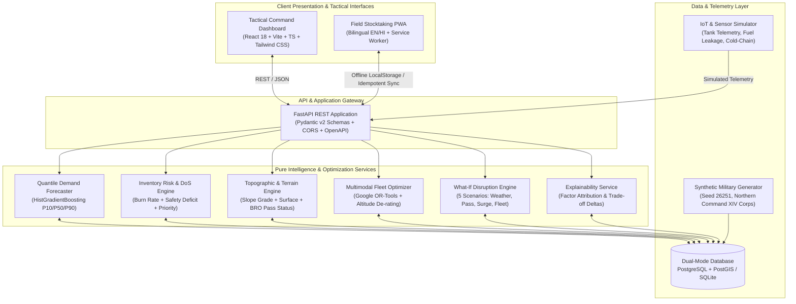

# System Architecture & Technical Specification

**Project:** Indian Army — Predictive Logistics & Forward Supply Chain (SIH PS 26251)  
**System Name:** VANGUARD-LOGIX (Forward Tactical Supply Chain Platform)  
**Architecture Document Version:** 1.0 (Phase 0 Baseline)  

---

## 1. Architectural Goals & Design Principles

1. **Modular Engine Decoupling:** Business and mathematical logic (forecasting, topographic physics, combinatorial routing) are implemented as pure, stateless services independent of database models or HTTP frameworks. This ensures testability, zero regression, and fast execution.
2. **Dual-Mode Data Portability:** While full production deployments leverage PostgreSQL 16+ with PostGIS spatial indexing, the architecture includes an automatic zero-config fallback to SQLite with mathematical spatial distance functions. This guarantees that evaluators, SIH judges, and developers can run the complete system locally with zero external service dependencies.
3. **Defense Doctrine & Terminology Fidelity:** Data schemas, UI terminology, and operational workflows strictly adhere to Indian Army standards (Northern Command XIV Corps operational theater, ASC/AOC Class I–V supply classes, IAF-Z-2096 requisition vouchers, BRO pass condition flags).
4. **Resilience & Offline-First Operation:** Forward outposts in VSAT/connectivity shadow zones can operate disconnected via an offline-first bilingual field interface with tamper-evident local voucher storage and automatic idempotent batch reconciliation upon link recovery.
5. **Explainability & Operational Safety:** Black-box predictions are prohibited. All algorithmic recommendations provide transparent factor decompositions (shortage severity, days of supply, route friction, vehicle altitude de-rating). All data is clearly watermarked as synthetic decision support.

---

## 2. High-Level System Architecture



---

## 3. Subsystem Breakdown & Responsibilities

### 3.1 Frontend: Tactical Command Dashboard & Field PWA
- **Tech Stack:** React 18, Vite 6, TypeScript 5, Tailwind CSS 3, Lucide Tactical Icons, Leaflet / Custom Tactical Canvas, Recharts.
- **Key Modules:**
  - `CommandDashboard`: Strategic command briefing, overall risk index, stockout countdown, decision flow strip (`DATA → FORECAST → RISK → PRIORITY → ALLOCATION → ROUTE → DECISION`).
  - `TacticalGISViewer`: Vector-styled topographic terrain map displaying Northern Command sectors, supply axes, pass status indicators, and active convoy tracks.
  - `PassMonitor`: Border Roads Organisation (BRO) mountain pass passability panel (Zojila, Khardung La, Chang La, Rohtang) with real-time status toggles.
  - `LoadOptimizer`: Multi-modal manifest builder with dynamic altitude engine/payload de-rating.
  - `IndentWorkflow`: Formal IAF-Z-2096 military requisition voucher generator with SHA-256 verification and offline queuing.
  - `FieldPWA`: Lightweight bilingual (English / हिंदी) stocktaking web application with Service Worker offline caching.
  - `WhatIfStudio`: Disruption stress-testing studio with before/after comparison tables and recommended response directives.

### 3.2 Backend: FastAPI Application & REST Gateway
- **Tech Stack:** Python 3.12+, FastAPI, Pydantic v2, Uvicorn.
- **Key Routers:**
  - `/api/dashboard`: Aggregated theater status, risk metrics, and top recommended actions.
  - `/api/forecast`: Multi-horizon demand predictions ($P_{10}, P_{50}, P_{90}$) with backtest metrics (WAPE, MAE, RMSE).
  - `/api/inventory`: Depot and forward post stock registers, Days-of-Supply (DoS) countdowns, and safety deficits.
  - `/api/passes`: Strategic mountain pass conditions and BRO road maintenance statuses.
  - `/api/routes`: Route network, topographic friction profiles, and alternative path evaluations.
  - `/api/dispatch`: Multimodal fleet optimization runs, vehicle manifests, and movement orders export.
  - `/api/indents`: IAF-Z-2096 voucher creation, queue tracking, and offline batch synchronization.
  - `/api/simulation`: What-If disruption scenario execution and comparative operational delta calculations.
  - `/api/iot`: Telemetry ingestion, sensor health heartbeats, and storage discrepancy alerts.

### 3.3 Intelligence & Optimization Engines (Pure Services)
1. **Quantile Demand Forecaster (`services/forecasting.py`):**
   - Implements gradient-boosted quantile regression (`HistGradientBoostingRegressor`) predicting 10th percentile ($P_{10}$ lean burn), 50th percentile ($P_{50}$ expected median), and 90th percentile ($P_{90}$ severe weather buffer).
   - Features: recent consumption lags (7, 14, 21 d), ambient temperature, snowfall rate, troop headcount, and seasonal heating demands.
   - Evaluated using rolling-origin walk-forward time series splits preventing target leakage.
2. **Topographic & Terrain Engine (`services/terrain.py`):**
   - Models road grade resistance using empirical mountain transport physics:
     $$\text{Grade Factor} = 1.0 + 0.035 \cdot |\theta| + 0.002 \cdot |\theta|^2$$
   - Combines surface friction (`HIGHWAY`: 1.0, `MOUNTAIN_ROAD`: 1.25, `UNPAVED_TRACK`: 1.55) with weather degradation and avalanche pass closures.
3. **Multimodal Fleet Optimizer (`services/optimizer.py`):**
   - Google OR-Tools constraint programming solving Capacitated Vehicle Routing with Time Windows (CVRPTW).
   - Dynamically balances heavy road trucks (Ashok Leyland 4x4 / 6x6), all-terrain snowcats (Bv-206), mule trains, and tactical helicopters (IAF Mi-17 V5 / ALH Dhruv).
   - Enforces daylight operating windows (0600–1700 hrs) and altitude payload de-rating above 3,500m MSL.
4. **Inventory Risk & DoS Engine (`services/inventory_risk.py`):**
   - Computes dynamic Days of Supply: $\text{DoS} = \text{Current Stock} / \text{Forward Daily Burn Rate}$.
   - Classifies risk levels (`NORMAL`, `WARNING`, `CRITICAL`) and computes multi-attribute priority scores ($0 \dots 100$).
5. **What-If Disruption Engine (`services/simulation.py`):**
   - Evaluates 5 pre-configured and custom disruption scenarios: `BASELINE`, `SEVERE_BLIZZARD`, `PASS_AVALANCHE_BLOCKAGE`, `TROOP_REINFORCEMENT_SURGE`, `AIRLIFT_CONTINGENCY`.
   - Computes exact before-and-after operational deltas ($\Delta$ Stockout Count, $\Delta$ Mean DoS, $\Delta$ Lift Tonnage, $\Delta$ Route Friction).
6. **Decision Explainability Service (`services/explainability.py`):**
   - Decomposes recommendation scores into human-readable causal contributions (e.g., $35\%$ sub-zero temperature drop, $30\%$ safety stock depletion, $20\%$ impending pass closure).

### 3.4 Data & Persistence Layer
- **Dual-Mode ORM:** SQLAlchemy 2.0 with async engine. Supports both PostgreSQL with PostGIS extension for enterprise deployment and SQLite for local self-contained execution.
- **Deterministic Seed Data:** Procedurally generated Northern Command synthetic logistics network anchored at fixed seed `26251`.
- **Entities:** Locations (Depots & Forward Posts), Routes & Strategic Passes, Supply Catalog (Classes I to V), Fleet Vehicles, Historical Consumption Records, Live Telemetry Events, Indent Vouchers, and Disruption Runs.

---

## 4. End-to-End Operational Data Flows

### 4.1 Predictive Risk & Dispatch Workflow
```
[Consumption History + Weather Outlook]
                  │
                  ▼
   Quantile Forecaster (P10 / P50 / P90)
                  │
                  ▼
   Days-of-Supply & Safety Deficit Engine
                  │
                  ▼
   Priority Ranking (0–100 Weighted Score)
                  │
                  ▼
  [Pass Status & Terrain Friction Check]
                  │
        ┌─────────┴─────────┐
        │ Pass OPEN         │ Pass BLOCKED
        ▼                   ▼
   Road Fleet CVRPTW    Contingency Air-Bridge (Mi-17) / Mules
        │                   │
        └─────────┬─────────┘
                  ▼
       Allocation & Manifest Builder
  (High-Altitude Payload De-rating Applied)
                  │
                  ▼
      Explainable Movement Order & CSV
```

### 4.2 Offline Field Voucher Synchronization
```
Forward Post Quartermaster (Offline / VSAT Down)
                  │
                  ▼
  Enters Stock Audit / Indent Requisition (Bilingual PWA)
                  │
                  ▼
  Signed Locally with Timestamp + SHA-256 Digest
                  │
                  ▼
  Stored in Local Secure Storage (IndexedDB / LocalStorage)
                  │
                  ▼
       [VSAT Carrier Restored]
                  │
                  ▼
  Idempotent Batch POST /api/indents/sync
                  │
                  ▼
  Database Ledger Updated & Stock Discrepancies Evaluated
```

---

## 5. Technology Stack Selection & Justification

| Layer | Selected Technology | Alternative Considered | Rationale for Selection |
|---|---|---|---|
| **Frontend Framework** | React 18 + Vite 6 + TypeScript 5 | Next.js 15 | Vite SPA offers instant startup, zero server-side rendering complexity, and seamless offline packaging without Node server dependencies. |
| **Styling & Icons** | Tailwind CSS 3 + Lucide Tactical | Ant Design / MUI | Tailwind delivers lightweight, custom-tailored utilitarian military themes with precise WCAG AA contrast control. |
| **Backend Framework** | Python 3.12+ / FastAPI | Django / Express | FastAPI provides high-performance asynchronous REST endpoints, automatic OpenAPI validation, and direct integration with scientific Python ML libraries. |
| **Optimization Solver** | Google OR-Tools | Custom Heuristic | OR-Tools is an industry-standard, mathematically proven constraint programming solver capable of solving CVRPTW with hard time windows and disjunctive penalties in seconds. |
| **Machine Learning** | scikit-learn (`HistGradientBoostingRegressor`) | Deep Learning (LSTM/Transformer) | Gradient boosted quantile trees provide superior tabular time-series performance on small-to-medium datasets, train in seconds, output native $P_{10}/P_{50}/P_{90}$ intervals, and offer transparent explainability without massive GPU overhead. |
| **Database** | Dual-Mode: PostgreSQL/PostGIS + SQLite | MongoDB / Neo4j | Relational structure matches defense inventory ledgers; dual-mode architecture guarantees both enterprise spatial scalability and 100% portable zero-setup local demonstration. |
